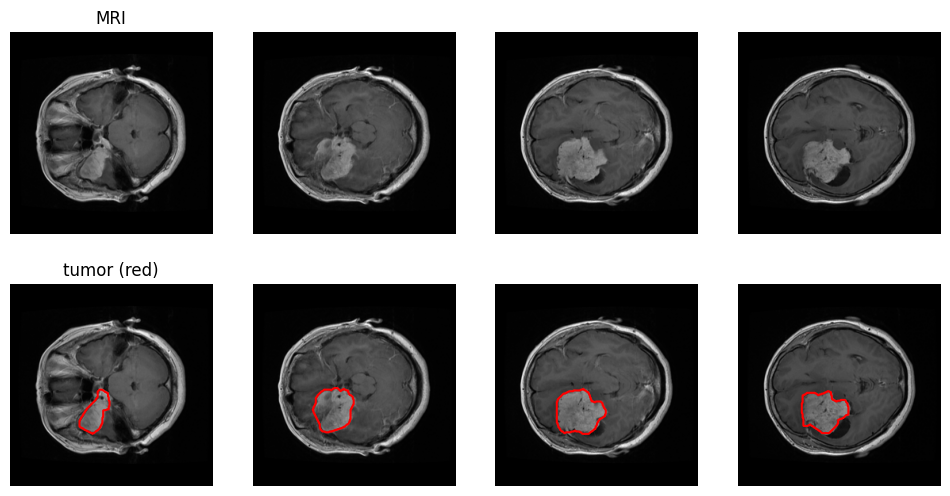
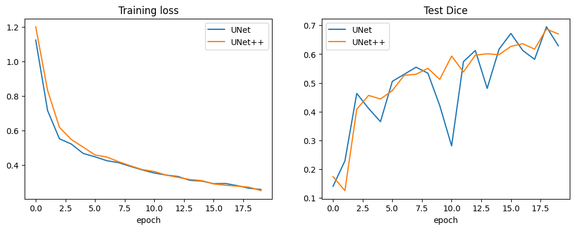
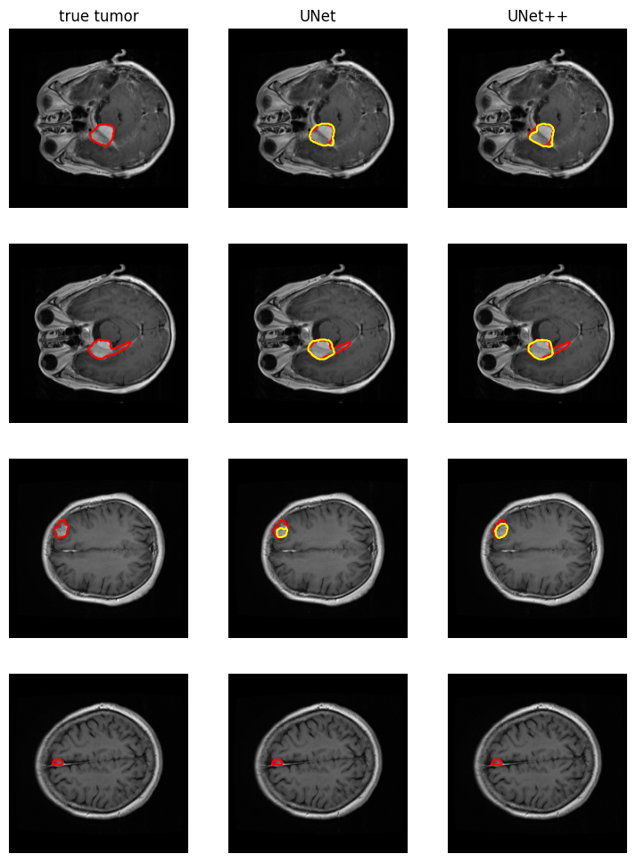

# Brain Tumor Segmentation with UNet and UNet++

This project trains UNet and UNet++ to segment brain tumors in MRI images and compares the two models on the same data with the same training setup.

## Dataset

[Figshare brain tumor dataset](https://huggingface.co/datasets/MedOtter/Figshare_Brain_Tumor) (Cheng et al., 2015), loaded from Hugging Face.

- 3,064 T1-weighted contrast-enhanced MRI slices from 233 patients
- Three tumor types: meningioma, glioma and pituitary tumor
- Each slice has a binary tumor mask
- Split: 2,522 training images, 542 test images

No account or manual download is needed. The notebook downloads the data with `load_dataset`.

## Models

Both models use the same building block: two 3x3 convolutions, each followed by batch normalization and ReLU. Both have 4 down-sampling levels.

- **UNet** (Ronneberger et al., 2015): an encoder–decoder with skip connections that copy encoder features straight to the decoder.
- **UNet++** (Zhou et al., 2018): the skip connections pass through extra nested conv blocks, so encoder and decoder features are more similar when they are joined.

| Model | Parameters |
|---|---|
| UNet | 7.9M |
| UNet++ | 9.2M |

## Training setup

Both models were trained with identical settings:

| Setting | Value |
|---|---|
| Image size | 256 x 256, grayscale |
| First-layer channels | 32 |
| Batch size | 16 |
| Epochs | 20 |
| Optimizer | Adam, learning rate 1e-3 |
| Loss | Binary cross-entropy + Dice loss |
| Augmentation | Random horizontal flip |
| Hardware | GPU |

## Results

Dice score on the 542 test images (1 = perfect overlap with the true tumor):

| Model | Final Dice (epoch 20) | Mean Dice, last 5 epochs | Time per epoch |
|---|---|---|---|
| UNet | 0.629 | 0.638 | 62 s |
| UNet++ | **0.670** | **0.648** | 165 s |

**Findings**

- UNet++ scored slightly higher than UNet.
- UNet++ was more stable during training. UNet's test Dice dropped sharply at some epochs, for example to 0.28 at epoch 11.
- UNet++ took about 2.7 times longer per epoch.
- The training loss of both models was still falling at epoch 20, so longer training should improve both.

Predictions on test images (red = true tumor, yellow = prediction):

Both models find the main tumor body well, including small tumors. Both miss thin, elongated parts of some tumors.

## How to run

1. Open `BrainTumorSegmentation.ipynb` in Google Colab, Kaggle or Jupyter.
2. Turn on a GPU. In Colab: *Runtime → Change runtime type → T4 GPU*.
3. Run all cells.

Requirements: `torch`, `datasets`, `numpy`, `matplotlib`, `pillow`. Colab and Kaggle already have everything except `datasets` (`pip install datasets`).

To train faster, set `IMAGE_SIZE = 128` and `BASE_CHANNELS = 16` in the first code cell. This takes a few minutes per model on a GPU, with lower accuracy.

## Possible improvements

- Train for more epochs
- Add a learning-rate schedule to reduce the jumps in test Dice
- Keep the best model based on a validation split instead of the last epoch
- Use a pretrained encoder, for example ResNet
- Add more augmentation, such as rotation and brightness changes

## References

- Cheng J. et al. *Enhanced Performance of Brain Tumor Classification via Tumor Region Augmentation and Partition.* PLoS ONE, 2015.
- Ronneberger O., Fischer P., Brox T. *U-Net: Convolutional Networks for Biomedical Image Segmentation.* MICCAI, 2015.
- Zhou Z. et al. *UNet++: A Nested U-Net Architecture for Medical Image Segmentation.* DLMIA, 2018.
